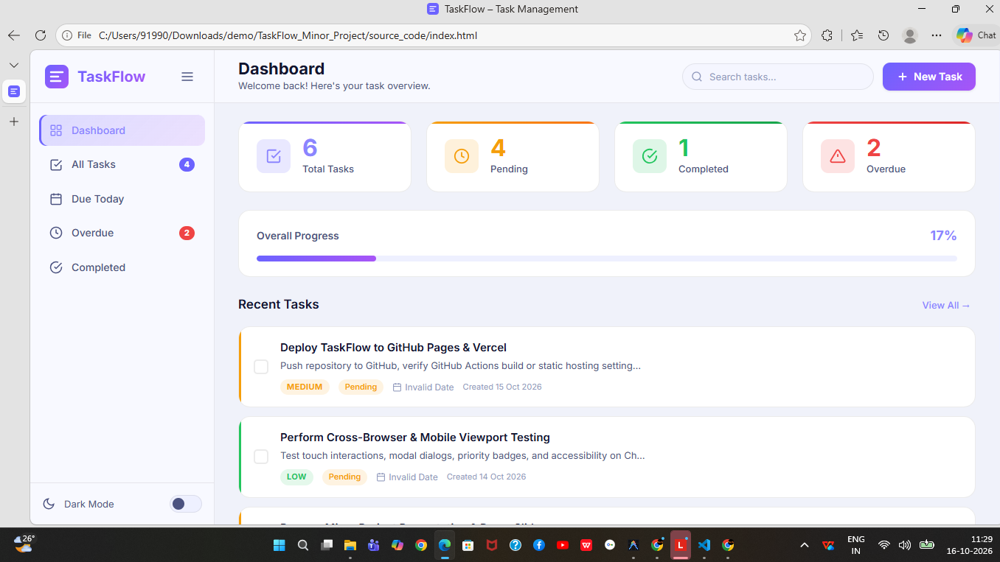
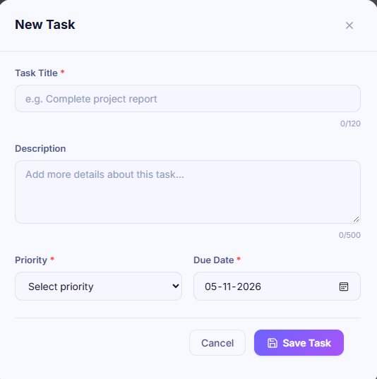
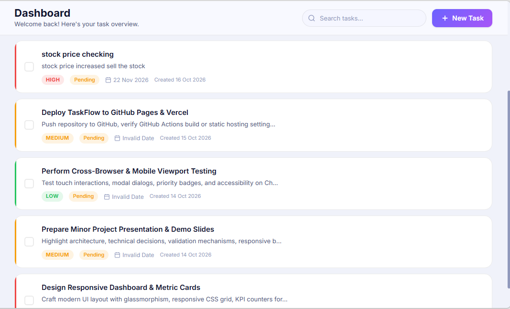

# TaskFlow – Task Management Web Application


> A premium, responsive task management web application built with HTML5, CSS3, and Vanilla JavaScript.

[](https://your-deployment-link.vercel.app)
[](https://github.com/your-username/taskflow)

---

## 📋 Table of Contents

- [Overview](#overview)
- [Features](#features)
- [Screenshots](#screenshots)
- [Tech Stack](#tech-stack)
- [Folder Structure](#folder-structure)
- [Getting Started](#getting-started)
- [Usage Guide](#usage-guide)
- [Local Storage](#local-storage)
- [Keyboard Shortcuts](#keyboard-shortcuts)
- [Deployment](#deployment)
- [License](#license)

---

## Overview

**TaskFlow** is a fully client-side task management web application designed to help users create, organize, and track tasks efficiently. It features a clean dark-themed UI with priority indicators, overdue detection, real-time filtering and searching, and persistent data via browser Local Storage.

---

## ✨ Features

### Task Management
- ✅ **Create** tasks with title, description, priority, due date, and status
- ✅ **Edit** any task inline via a modal form
- ✅ **Delete** tasks with a confirmation dialog to prevent accidental deletion
- ✅ **Toggle** completion status with a single click/checkbox
- ✅ **Mark tasks** as pending or completed

### Dashboard & Organization
- 📊 **Live statistics** – Total, Pending, Completed, Overdue counts with animated numbers
- 📈 **Progress bar** showing overall completion percentage
- 🔍 **Global search** across task title and description (debounced for performance)
- 🔽 **Filter** by completion status (All / Pending / Completed / Overdue)
- 🔽 **Filter** by priority (All / High / Medium / Low)
- ↕️ **Sort** by creation date, due date, priority, or title
- 📅 **Due Today** view – Tasks specifically due today
- ⚠️ **Overdue** view – Automatically detected overdue tasks
- ✅ **Completed** view – Archived completed tasks

### Visual Indicators
- 🔴 **High** priority badge (red)
- 🟠 **Medium** priority badge (orange/amber)
- 🟢 **Low** priority badge (green)
- ⚠️ Overdue tasks highlighted in red
- 🟡 Tasks due today highlighted in amber
- Coloured left-border stripe per priority on each task card

### Validation & Data
- Required field validation with inline error messages
- Character counters for title (120 chars) and description (500 chars)
- **Local Storage** persistence – tasks survive browser refresh/close
- Sample data pre-loaded on first run

### UI/UX
- 🌙 **Dark / Light theme** toggle (persisted)
- 📱 **Fully responsive** – Desktop, tablet, and mobile
- ⌨️ **Keyboard shortcuts** (Ctrl+N, Ctrl+F, Escape)
- 🔔 Toast notifications for all actions
- Smooth animations and micro-interactions
- Floating Action Button (FAB) on mobile

---

## 📸 Screenshots

| Dashboard | Task Form |
|-----------|-----------|
|  |  |

| Task List | Mobile View |
|-----------|-------------|
|  |  |

---

## 🛠 Tech Stack

| Technology | Purpose |
|------------|---------|
| **HTML5** | Semantic markup, accessibility (ARIA) |
| **CSS3** | Responsive layout, animations, dark/light themes, CSS Custom Properties |
| **JavaScript (ES6+)** | Application logic, DOM manipulation, event handling |
| **Browser Local Storage** | Client-side data persistence |
| **Google Fonts (Inter)** | Typography |

---

## 📁 Folder Structure

```
TaskFlow_Minor_Project/
├── source_code/
│   ├── index.html          # Main HTML file
│   ├── style.css           # Complete stylesheet with dark/light themes
│   ├── script.js           # Full application logic
│   └── assets/
│       └── banner.svg      # Project banner
├── screenshots/
│   ├── dashboard.png
│   ├── task_form.png
│   ├── task_list.png
│   └── mobile_view.png
├── Project_Report.pdf
├── README.md               # This file
└── GitHub_Repository_Link.txt
```

---

## 🚀 Getting Started

### Prerequisites
- Any modern web browser (Chrome, Firefox, Edge, Safari)
- No installation, npm, or build tools required!

### Running Locally

**Option 1 – Direct open:**
```
Double-click source_code/index.html
```

**Option 2 – VS Code Live Server:**
1. Install the [Live Server](https://marketplace.visualstudio.com/items?itemName=ritwickdey.LiveServer) extension
2. Right-click `index.html` → **Open with Live Server**

**Option 3 – Python HTTP Server:**
```bash
cd source_code
python -m http.server 8080
# Visit: http://localhost:8080
```

**Option 4 – Node.js:**
```bash
cd source_code
npx serve .
# Visit: http://localhost:3000
```

---

## 📖 Usage Guide

### Creating a Task
1. Click **New Task** (top-right button) or press **Ctrl+N**
2. Fill in the task title *(required)*
3. Add an optional description
4. Select **Priority** – High, Medium, or Low *(required)*
5. Pick a **Due Date** *(required)*
6. Set the **Status** – Pending or Completed
7. Click **Save Task**

### Editing a Task
- Hover over any task card and click the **pencil icon**
- Modify any field and click **Update Task**

### Deleting a Task
- Hover over a task card and click the **trash icon**
- A confirmation dialog appears — click **Delete Task** to confirm

### Searching Tasks
- Type in the **search bar** (top-right) — results filter live as you type
- Automatically switches to the **All Tasks** view with results highlighted

### Filtering & Sorting (All Tasks view)
- Use the **Status**, **Priority**, and **Sort By** dropdowns
- Click **Clear** to reset all filters

### Theme Toggle
- Use the **Dark Mode** switch in the sidebar footer

---

## 💾 Local Storage

TaskFlow uses **`localStorage`** under the key `taskflow_tasks_v1` to persist all task data.

```javascript
// Data is automatically saved after every create/edit/delete
localStorage.setItem('taskflow_tasks_v1', JSON.stringify(tasks));

// And loaded on page startup
const tasks = JSON.parse(localStorage.getItem('taskflow_tasks_v1')) || [];
```

**Task Object Schema:**
```json
{
  "id":          "tf_1728000000000_abc123",
  "title":       "Write project report",
  "description": "Detailed description of the task",
  "priority":    "high",
  "status":      "pending",
  "dueDate":     "2026-10-20",
  "createdAt":   "2026-10-15T10:00:00.000Z",
  "updatedAt":   "2026-10-15T10:00:00.000Z"
}
```

---

## ⌨️ Keyboard Shortcuts

| Shortcut | Action |
|----------|--------|
| `Ctrl + N` | Open New Task modal |
| `Ctrl + F` | Focus search bar |
| `Escape`   | Close any open modal |

---

## 🌐 Deployment

### GitHub Pages
```bash
# Push your code to a GitHub repository, then:
# Go to Settings → Pages → Source → Deploy from branch (main / root or /docs)
```

### Vercel
```bash
# Install Vercel CLI
npm i -g vercel
# Deploy from source_code folder
cd source_code && vercel
```


---

## 📄 License

This project was created as an academic minor project submission.

---

